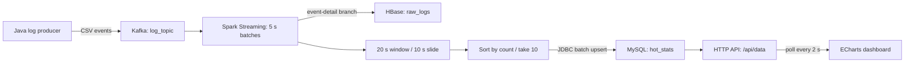

# Real-Time Log Analysis & Hot Keyword Dashboard

A Java stream-processing demo that turns simulated search events into a rolling keyword ranking. Kafka separates event production from Spark Streaming; HBase stores event details; MySQL serves compact ranking updates through an HTTP API and an ECharts dashboard.

The project explores a data-infrastructure problem: **how to separate ingestion, processing, storage, and serving while making the trade-offs between freshness, write cost, and recovery explicit.** The supplied launcher runs Spark in `local[2]` mode; it demonstrates a distributed-systems architecture, but does not establish multi-node performance or production reliability.

## At a glance

| Property | Current implementation |
| --- | --- |
| Input | CSV events: `user_id,keyword,timestamp_ms,region` |
| Ingestion | Kafka topic `log_topic`, direct DStream consumer |
| Processing cadence | 5-second micro-batches |
| Ranking | 20-second processing-time window, sliding every 10 seconds; up to 10 keywords |
| Detail storage | HBase `raw_logs`, column family `info` |
| Serving storage | MySQL `bigdata.hot_stats`, keyword-keyed upserts |
| Presentation | `GET /api/data` on port 8080; ECharts treemap and ranking list, polled every 2 seconds |

These are source-verified settings, **not measured throughput or end-to-end latency results**.

## Architecture and data flow



1. [LogProducer.java](demo/src/main/java/com/example/producer/LogProducer.java) generates a random user ID, keyword, region, and millisecond timestamp. The Kafka message key is the user ID. Its 200–999 ms sleep makes it a low-rate demonstration source, not a load generator.
2. [HotKeywordApp.java](demo/src/main/java/com/example/spark/HotKeywordApp.java) consumes Kafka records in 5-second micro-batches. One output branch writes event details to HBase; another counts keywords over a rolling window and selects the top 10.
3. [MySQLUtils.java](demo/src/main/java/com/example/util/MySQLUtils.java) batches the ranking upserts. [WebServer.java](demo/src/main/java/com/example/web/WebServer.java) reads the table on request and returns JSON.
4. [index.html](demo/src/main/resources/web/index.html) refreshes the treemap and ranking list without querying Spark or HBase.

Kafka decouples the producer from the consumer, and MySQL decouples dashboard reads from stream computation. The HBase and MySQL branches still share one Spark application; they are not independent failure domains.

## Key design decisions and trade-offs

### Micro-batches and overlapping windows

The **5-second batch interval** limits how often Spark schedules new input work. The **20-second window / 10-second slide** combines four batch intervals into each full window and produces a ranking every two intervals. Consecutive full windows overlap by 10 seconds, so their counts must not be added as independent event totals.

This is **processing-time windowing**: the payload timestamp is used in the HBase key, but does not determine window membership. There are no event-time watermarks or late-event corrections. A replayed old event can enter the current processing window.

A shorter batch interval would create more scheduling overhead; a shorter slide would calculate and write rankings more often. These settings demonstrate a freshness/cost trade-off, not a measured optimum. The reducer uses the non-inverse `reduceByKeyAndWindow` overload, followed by a full descending sort; incremental window maintenance and a bounded top-K strategy are possible next steps as input and keyword cardinality grow.

### HBase RowKey and write path

The key is `userId_timestampMs`, with `info:keyword` and `info:region` stored as two separate Put calls. User ID and timestamp are recoverable from the key; the complete original CSV is not stored as a cell.

The random user-ID prefix in the supplied generator avoids a monotonically increasing timestamp prefix and can spread keys across the key space. Actual region distribution depends on table splits and workload; this repository contains no hotspot benchmark. The layout groups keys by user prefix, while global time-range queries would require scanning across users or another index. The same user and millisecond also map to the same row, so the key is not a general unique event identifier.

[HBaseUtils.java](demo/src/main/java/com/example/util/HBaseUtils.java) reuses a connection per JVM. However, each field write opens/closes a Table handle and issues a synchronous Put. Combining both columns in one Put and using buffered writes would reduce per-event overhead; those optimizations are not implemented here.

### Small serving table and batched writes

Spark collects at most 10 ranked pairs to the driver and submits them through one JDBC batch per nonempty ranking update. This keeps the serving write payload small and avoids writing one SQL statement per incoming event. The full sort still happens before `take(10)`, so a small result does not imply a cheap aggregation.

The MySQL upsert **replaces** each keyword's count; it does not accumulate lifetime totals. Keywords absent from a later result are not deleted, and an empty window triggers no write. Consequently, the API can show stale rows and is not a strict snapshot of the latest window. Exact snapshot semantics would require expiration or a window-versioned, atomically published ranking.

### Freshness and recovery boundaries

The visible update path includes batch alignment, waiting for a ranking slide, processing and database time, and the browser's next poll. **A 5-second batch interval does not mean a 5-second end-to-end latency guarantee.** The frontend can poll several times before a new ranking is available.

The consumer sets `enable.auto.commit=false` and `auto.offset.reset=latest`, but the code does not commit offsets or configure a streaming checkpoint. There is no durable restart/replay protocol. Sink exceptions are logged and may be swallowed, the two databases have no shared transaction, and the two HBase field writes can partially succeed. Deterministic row keys and SQL replacement writes alone do not provide end-to-end exactly-once processing.

## Reproduce the demo

### Prerequisites

Provision these services **before** running the application:

- A Bash environment, JDK 8, Maven, and Spark 3.4.0 built for Scala 2.12, with `java`, `mvn`, and `spark-submit` on `PATH`.
- A reachable Kafka broker and topic `log_topic`; Kafka console tools for the controlled-input check below.
- HBase reachable through ZooKeeper, with table `raw_logs` and column family `info`.
- MySQL with database `bigdata`, table `hot_stats`, and a user allowed to read and upsert it.
- A browser that can load ECharts from jsDelivr. Python 3 is used only by the verification recipe.

[pom.xml](demo/pom.xml) pins Spark 3.4.0, HBase client/common 2.5.0, MySQL Connector/J 8.0.33, and Fastjson 1.2.83. Spark dependencies marked `provided` must come from the Spark runtime. The repository also includes Maven 3.8.8; Maven still needs access to its plugins and project dependencies. Kafka broker, MySQL server, and the deployed HBase cluster versions are not pinned by this repository.

### 1. Configure the endpoints

```bash
git clone https://github.com/BearWithMax/realtime-log-analysis.git
cd realtime-log-analysis/demo
```

Configuration is currently split between source constants and a properties file. **Editing only `config.properties` is insufficient.** Update the following before building:

| File | Values to check |
| --- | --- |
| [LogProducer.java](demo/src/main/java/com/example/producer/LogProducer.java) | Kafka bootstrap address and topic |
| [HotKeywordApp.java](demo/src/main/java/com/example/spark/HotKeywordApp.java) | Kafka address, topic, group ID, offset policy |
| [HBaseUtils.java](demo/src/main/java/com/example/util/HBaseUtils.java) | ZooKeeper quorum and client port |
| [MySQLUtils.java](demo/src/main/java/com/example/util/MySQLUtils.java) | JDBC URL, username, password; writer uses `hot_stats` |
| [config.properties](demo/src/main/resources/config.properties) | JDBC settings used by the HTTP reader; its Kafka/HBase entries are not loaded by the processing code |

The Kafka address and ZooKeeper quorum in the source are private-network examples. The writer's `localhost` JDBC address resolves on the Spark driver's host. Keep writer and reader pointed at the same database, use credentials for an isolated demo environment, and do not publish real credentials.

### 2. Initialize storage

Use a dedicated demo database/table. The following is the minimal schema required by the current SQL:

```sql
CREATE DATABASE IF NOT EXISTS bigdata CHARACTER SET utf8mb4;
USE bigdata;
CREATE TABLE IF NOT EXISTS hot_stats (
    keyword VARCHAR(255) NOT NULL PRIMARY KEY,
    count INT NOT NULL
) CHARACTER SET utf8mb4;
```

In the HBase shell, create the table if it does not already exist:

```ruby
create 'raw_logs', 'info'
```

Create the Kafka topic with the broker address for your environment; the single partition and replica below are for a minimal demo:

```bash
export KAFKA_BOOTSTRAP=localhost:9092  # replace with your reachable broker
kafka-topics.sh --bootstrap-server "$KAFKA_BOOTSTRAP" \
  --create --if-not-exists --topic log_topic \
  --partitions 1 --replication-factor 1
```

### 3. Build, start, and inspect

```bash
mvn clean package -DskipTests
bash start.sh
tail -f web_server.log spark_app.log producer.log
```

The launcher starts the HTTP server, Spark job in `local[2]`, and simulated producer. It does **not** start Kafka, HBase, ZooKeeper, or MySQL. It uses fixed sleeps rather than readiness checks, and an existing JAR skips its automatic build; rebuild after changing source or properties.

Open [the dashboard](http://localhost:8080/) and inspect the API:

```bash
curl -fsS http://localhost:8080/api/data
```

Response shape (illustrative values, not recorded benchmark output):

```json
[{"name":"Spark大数据","value":8},{"name":"Kafka消息队列","value":5}]
```

Check all three logs for connection or write failures. The API can return HTTP 200 with `[]` after a database error, and can serve stale rows, so a successful HTTP response alone does not prove a healthy pipeline. Spark's driver UI, normally on port 4040 while the application runs, provides batch processing and scheduling-delay information.

Stop the three application processes with:

```bash
bash stop.sh
```

The stop script sends termination signals to recorded PIDs. It does not implement a coordinated drain or stop external infrastructure.

## Verification and reproducible results

### Evidence available in this repository

| Evidence | What it establishes |
| --- | --- |
| Source parameters and output paths linked above | 5/20/10-second timing configuration, RowKey format, top-10 selection, JDBC batching, API contract, and 2-second polling |
| Controlled-input recipe below | A repeatable way to check ingestion, detail storage, ranking, and serving together |
| Performance measurements | No archived throughput, p50/p95 latency, before/after comparison, or failure-recovery results are included |

The controlled-input values below are **expected functional results**, not a claim that an end-to-end run or performance benchmark has already been recorded.

### Controlled-input check: 10 events, expected counts 6 / 3 / 1

Use an isolated demo environment with an empty `hot_stats` table and no other producer on `log_topic`. Start from stopped application processes. From `demo/`, after building, launch only the server and Spark job:

```bash
nohup mvn exec:java -Dexec.mainClass=com.example.web.WebServer > web_server.log 2>&1 &
echo $! > web_server.pid
nohup spark-submit --class com.example.spark.HotKeywordApp --master 'local[2]' \
  target/demo-1.0-SNAPSHOT-jar-with-dependencies.jar > spark_app.log 2>&1 &
echo $! > spark_app.pid
```

Wait until Spark has assigned Kafka partitions and completed empty batches; `latest` means sending before consumer initialization can skip the fixture. Then inject ten events in one short burst:

```bash
python3 - <<'PY' | kafka-console-producer.sh --bootstrap-server "$KAFKA_BOOTSTRAP" --topic log_topic
import time
base = int(time.time() * 1000)
keywords = ["demo_alpha"] * 6 + ["demo_beta"] * 3 + ["demo_gamma"]
for i, keyword in enumerate(keywords):
    print(f"fixture_{i:02d},{keyword},{base + i},test_region")
PY
```

Observe `spark_app.log` and poll `/api/data` every 2 seconds while the fixture is still in the window. At a ranking output whose 20-second window contains all ten events, the expected result is:

```json
[{"name":"demo_alpha","value":6},{"name":"demo_beta","value":3},{"name":"demo_gamma","value":1}]
```

The fixture must be consumed within a common 20-second window. If startup delay or backlog prevents that, inspect batch delays and repeat in a fresh isolated run. JSON object key order is irrelevant; compare keyword/count pairs.

Cross-check MySQL with `SELECT keyword, count FROM bigdata.hot_stats ORDER BY count DESC;`. In the HBase shell, `scan 'raw_logs', {ROWPREFIXFILTER => 'fixture_'}` should show ten rows with matching `info:keyword` and `info:region` values in a fresh table. Save the API response, SQL output, HBase scan, and logs together as evidence.

After the fixture ages out, the current implementation can retain the last upserted counts. This check also exposes the serving-table expiration limitation; a nonempty dashboard after input stops is not proof of new traffic. Finish with `bash stop.sh`.

### How to measure performance without confusing cadence with latency

For a measured result, record the commit, hardware, service versions/topology, Kafka partition count, Spark master/resources, event size/rate, duration, and warm-up period. The default random producer is unsuitable for a throughput benchmark.

Track completed and failed writes as well as input volume. Record Spark processing time and scheduling delay across batches; persistent processing times above the 5-second batch interval indicate that work cannot keep pace. To measure event-to-API visibility, add an isolated probe keyword and record its send time and first observed API appearance, with synchronized clocks and polling resolution disclosed. The current API does not expose event timestamps or window IDs, so it cannot independently report event-level latency.

Compare one change at a time—for example, a combined/buffered HBase write path or a different batch/slide interval—under the same workload, then report throughput, p50/p95 visibility latency, and missing/failed writes. No speedup percentage is claimed here without such measurements.

## Project highlights

- **Pipeline decomposition:** separate event ingestion, stream computation, event-detail storage, and read-oriented serving.
- **Explicit time semantics:** relate batch interval, overlapping windows, and dashboard polling to observable freshness.
- **Storage and access-path reasoning:** explain the RowKey's distribution/query trade-off and MySQL's compact ranking writes.
- **Reliability analysis:** identify offset recovery, partial sink writes, and stale serving state as concrete next engineering steps.

A concise project description suitable for a portfolio or application:

> Implemented a Java log-analysis pipeline connecting Kafka, Spark Streaming, HBase, and MySQL, with 5-second micro-batches, a 20-second rolling keyword window updated every 10 seconds, and an HTTP/ECharts dashboard. The project examines ingestion/serving separation, RowKey access patterns, batched ranking writes, and the limits of freshness and recovery guarantees in a working demo design.

## Repository map

```text
demo/
  pom.xml
  start.sh / stop.sh
  src/main/java/com/example/
    producer/LogProducer.java
    spark/HotKeywordApp.java
    util/HBaseUtils.java
    util/MySQLUtils.java
    web/WebServer.java
  src/main/resources/
    config.properties
    web/index.html
maven/                         # bundled Maven 3.8.8 distribution/archive
```

The compiled HTTP entry point is under `src/main/java`; the duplicate `WebServer.java` under resources is not the application source entry point.
